<div align="center">


# VLC Neon

**The VLC you know, with a neon glow — seek previews, Picture-in-Picture, speed & repeat presets and more.**

[](https://github.com/TaoufikGFX/vlc-neon/releases/latest)
[](COPYING)
[](#-fedora-rpm)
[](#-appimage-any-distribution)
[](#-flatpak-bundle)
[](https://ko-fi.com/taoufikmouadab)

[Website](https://taoufikgfx.github.io/vlc-neon/) · [Download](https://github.com/TaoufikGFX/vlc-neon/releases/latest) · [Changelog](CHANGELOG.md)

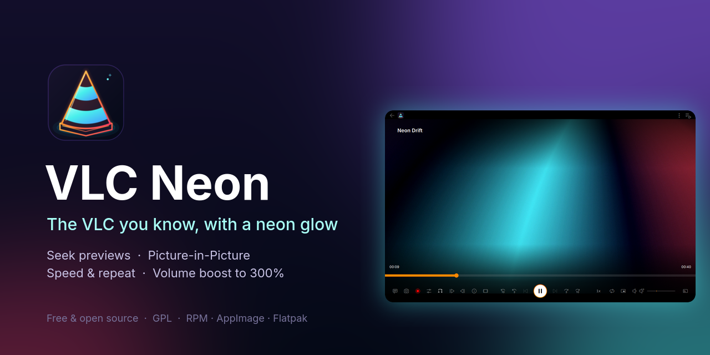

</div>

VLC Neon is an unofficial build of the **VLC 4** media player for Linux. It keeps VLC's engine, codecs and interface, and adds a neon identity and a set of everyday playback controls. It installs next to your regular VLC, with its own command, settings and launcher.

> Based on VLC media player by VideoLAN. Not an official VideoLAN product.

## ✨ Features

- 🖼️ **Seek-bar previews** — hover the timeline to see a thumbnail and timestamp (also in fullscreen)
- 📺 **Picture-in-Picture** — the video in a small always-on-top window with its own seek bar, ±3 s / ±10 s, play/pause and mute
- ⏩ **Speed presets** — 0.25× to 4× from one click on the speed button
- 🔁 **Repeat** — Off, 1–5 extra plays or Unlimited, with a badge on the button; remembered between sessions
- 🔊 **Volume boost** — 125 % to 300 % with a peak limiter
- ⏯️ **Resume where you left off** — prompt for local files, history of the last 100, per-file speed, volume, tracks and delays
- ℹ️ **Video info panel** — resolution, codecs, decoder and hardware decoding at a glance, with copy buttons
- ⏱️ **±3 s skip buttons** and an extended toolbar: screenshot, record, A–B loop, frame stepping
- 📋 **Copy current timestamp / media path**, open containing folder
- ⌨️ **Hotkeys** — ←/→ 5 s, Shift 10 s, Ctrl 60 s, E / Shift+E next/previous frame
- 🎞️ **Animated GIFs** play and loop
- 💜 **Neon look** — new icon, Inter typography with tabular figures, light and dark themes
- 🧩 **Side by side with VLC** — own binary (`vlc-neon`), app ID, settings (`~/.config/vlc-neon`) and MPRIS name

## 📸 Screenshots

<table>
<tr>
<td width="50%">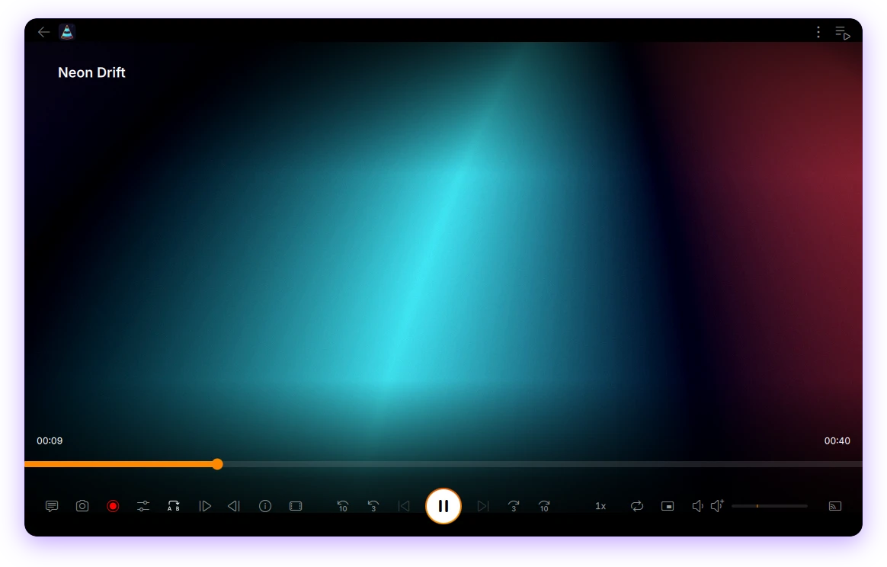<br><sub>Main player (dark)</sub></td>
<td width="50%">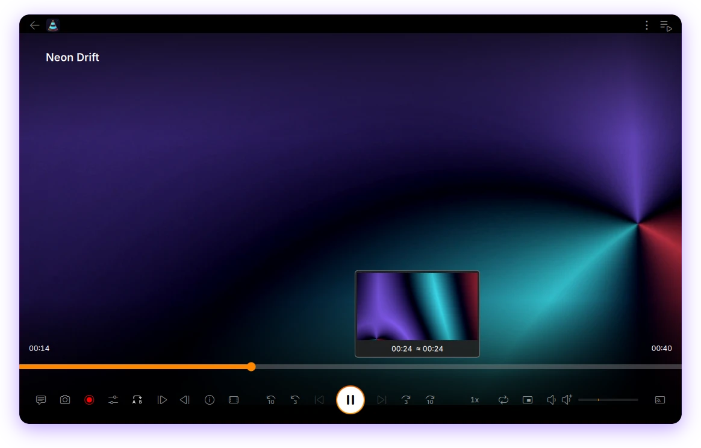<br><sub>Seek-bar preview</sub></td>
</tr>
<tr>
<td>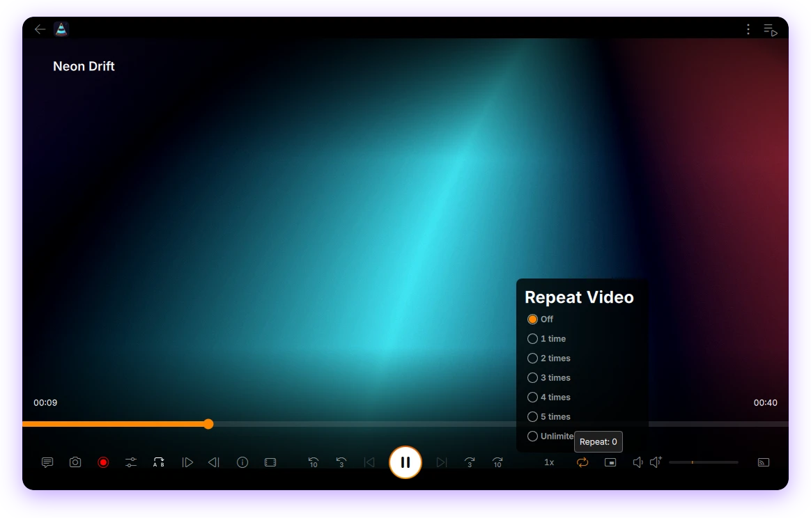<br><sub>Repeat: 1–5 times or unlimited</sub></td>
<td>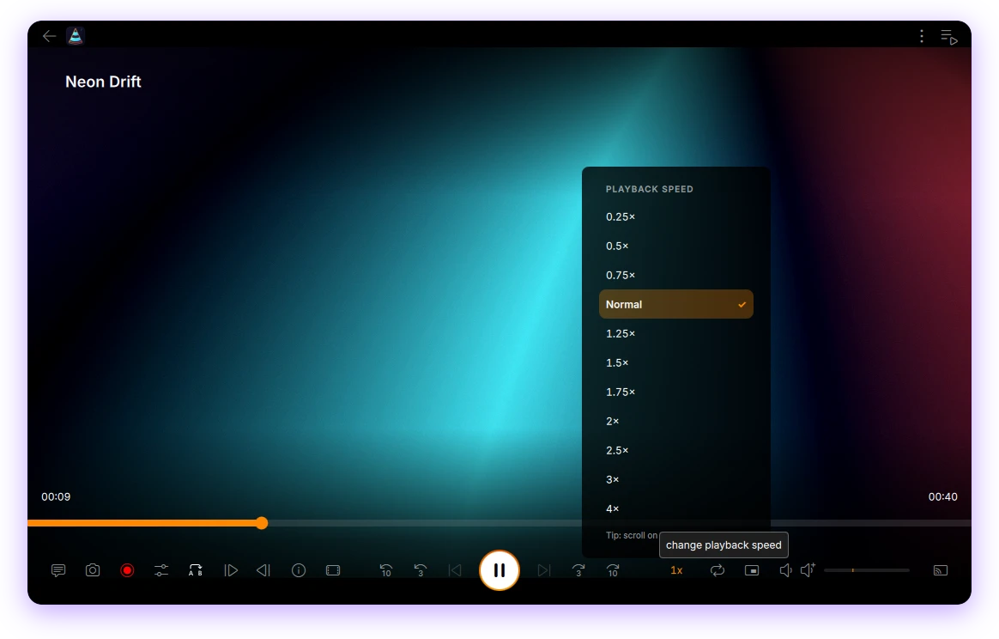<br><sub>Speed presets</sub></td>
</tr>
<tr>
<td>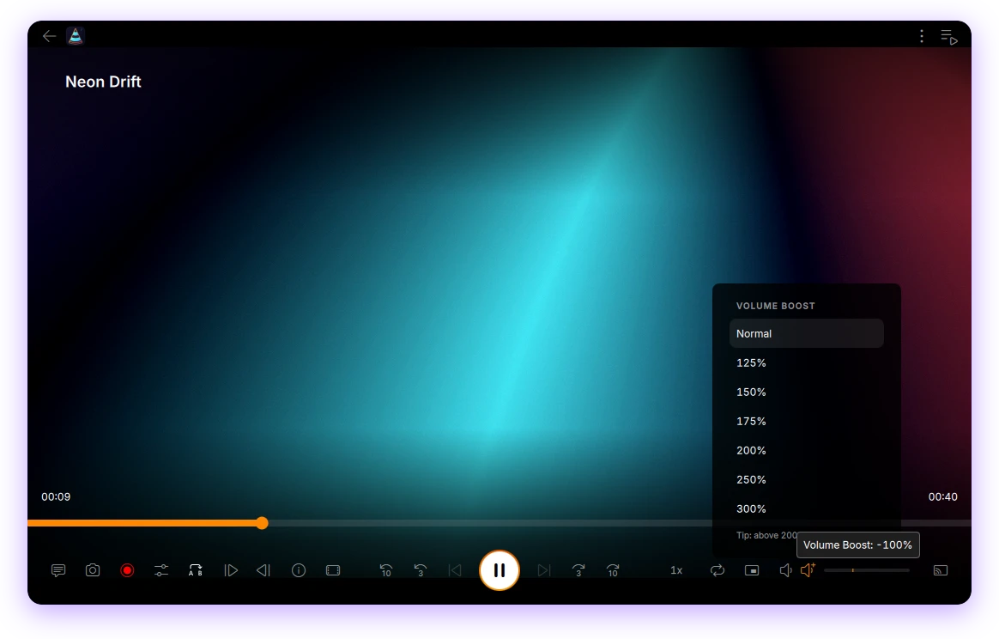<br><sub>Volume boost up to 300 %</sub></td>
<td>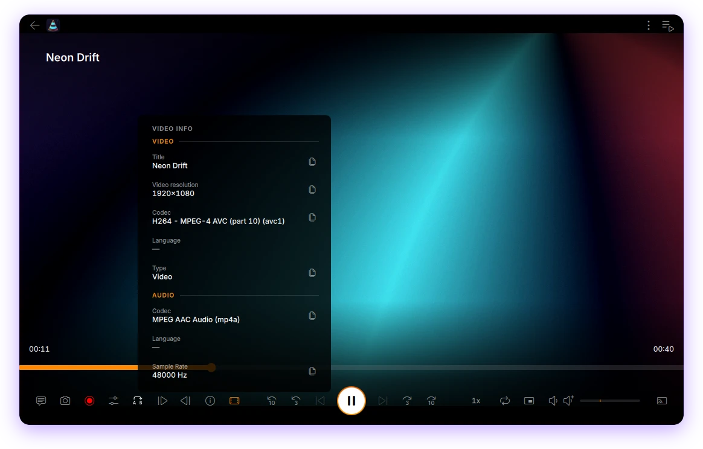<br><sub>Video info panel</sub></td>
</tr>
<tr>
<td>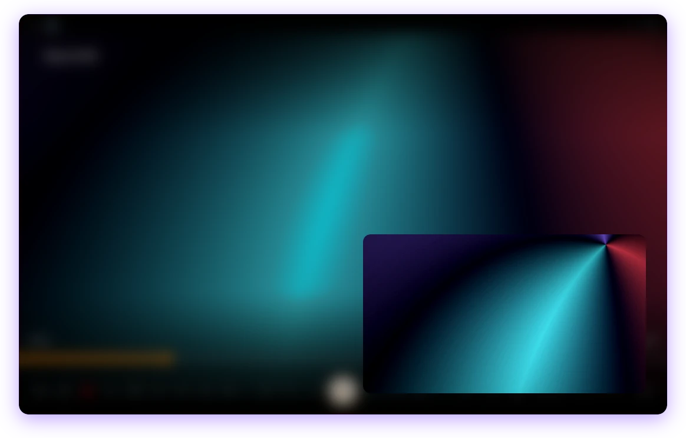<br><sub>Picture-in-Picture</sub></td>
<td>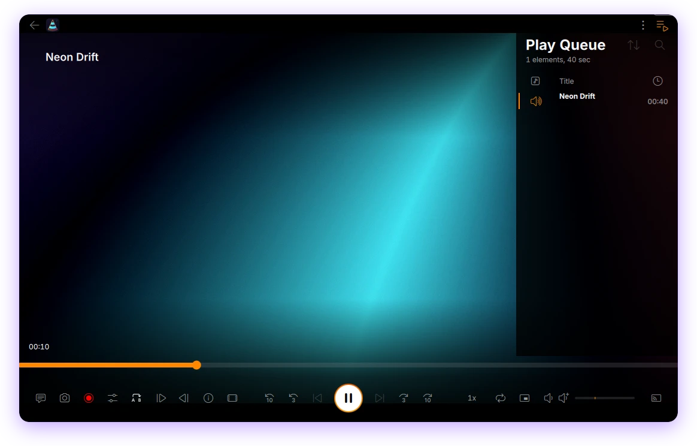<br><sub>Play queue</sub></td>
</tr>
<tr>
<td>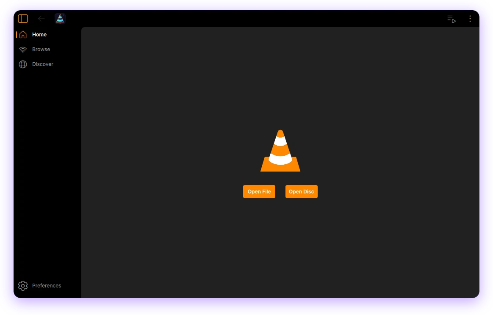<br><sub>Home (dark)</sub></td>
<td>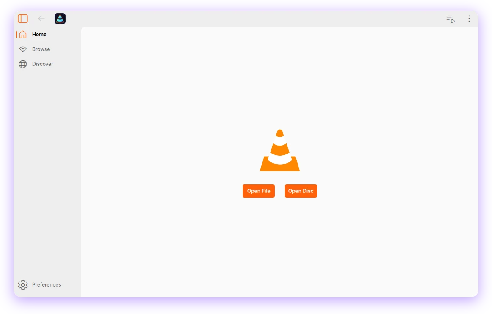<br><sub>Home (light)</sub></td>
</tr>
</table>

<sub>The video in the screenshots is an abstract animation generated with FFmpeg for this page.</sub>

## 📦 Install

Download the files from the [latest release](https://github.com/TaoufikGFX/vlc-neon/releases/latest). Each release includes a `SHA256SUMS` file:

```bash
sha256sum -c SHA256SUMS --ignore-missing
```

### 🎩 Fedora (RPM)

Built for **Fedora 44** (x86_64). Installs into `/opt/vlc-neon` and does not touch Fedora's `vlc` package.

```bash
sudo dnf install ./vlc-neon-1.0.1-1.fc44.x86_64.rpm
```

Remove with `sudo dnf remove vlc-neon`. For H.264/HEVC playback, Fedora's `openh264` or RPM Fusion's full FFmpeg (`ffmpeg-libs`) is recommended, as with any player using the system FFmpeg.

### 🧊 AppImage (any distribution)

Runs on x86_64 distributions with glibc 2.39 or newer (Ubuntu 24.04+, Debian 13+, Fedora 40+, …). Qt 6.11 and the libraries VLC needs are bundled.

```bash
chmod +x vlc-neon-1.0.1-x86_64.AppImage
./vlc-neon-1.0.1-x86_64.AppImage
```

If it does not start, install FUSE 2 (`libfuse2t64` on Ubuntu, `fuse-libs` on Fedora) or run it with `--appimage-extract-and-run`.

### 📦 Flatpak bundle

Uses the KDE 6.11 runtime from Flathub (installed automatically if you have the Flathub remote).

```bash
flatpak install --user ./vlc-neon-1.0.1.flatpak
flatpak run io.github.TaoufikGFX.vlc-neon
```

Remove with `flatpak uninstall --user io.github.TaoufikGFX.vlc-neon`.

### 🪟 KDE Plasma: Picture-in-Picture placement (optional)

On Wayland, only the compositor can keep a window above others and place it. The RPM ships a small KWin script for that; enable it once:

```bash
kpackagetool6 --type=KWin/Script --install /usr/share/kwin/scripts/vlc-neon-pip
kwriteconfig6 --file kwinrc --group Plugins --key vlc-neon-pipEnabled true
gdbus call --session --dest org.kde.KWin --object-path /KWin --method org.kde.KWin.reconfigure
```

For the AppImage or Flatpak, use [`packaging/kde/vlc-neon-pip`](packaging/kde/vlc-neon-pip) from this repository instead of the `/usr/share` path.

## 🛠️ Build from source

This repository holds VLC Neon's changes as **patches on top of a pinned upstream VLC commit** (see [`UPSTREAM`](UPSTREAM)), plus the packaging.

```bash
git clone https://github.com/TaoufikGFX/vlc-neon.git
cd vlc-neon
./scripts/fetch-upstream.sh        # downloads VLC at the pinned commit into ./upstream
./scripts/build.sh                 # applies patches/, builds with meson, installs into ./dist/root
```

`build.sh` needs the usual VLC 4 build dependencies (meson ≥ 1.10, Qt ≥ 6.2 with private headers, FFmpeg, …); the Fedora list is in [`packaging/rpm/vlc-neon.spec`](packaging/rpm/vlc-neon.spec). Packages:

| Package | How |
|---|---|
| RPM | `scripts/make-source-tarball.sh` then `rpmbuild -ta dist/vlc-neon-1.0.1-source.tar.gz` (or use [`packaging/rpm/Containerfile`](packaging/rpm/Containerfile)) |
| AppImage | `podman build -t vlc-neon-appimage packaging/appimage` then `podman run --rm -v "$PWD:/src:Z" -w /src vlc-neon-appimage packaging/appimage/build-appimage.sh` |
| Flatpak | `flatpak-builder --user --repo=repo build packaging/flatpak/io.github.TaoufikGFX.vlc-neon.yml` then `flatpak build-bundle repo vlc-neon.flatpak io.github.TaoufikGFX.vlc-neon` |

[`tests/smoke-test.sh`](tests/smoke-test.sh) checks a package in a clean container (plugins, audio/video decoding, and the Qt interface with the built-in Neon integration test).

| Patch | What it changes |
|---|---|
| `0001-vlc-neon-app-identity` | `vlc-neon` binary, app ID, own XDG folders and MPRIS name |
| `0002-core-playback-repeat-thumbnails-snapshots` | unlimited repeat, accurate seek thumbnails, hardware-video snapshots, hotkeys |
| `0003-modules-gif-dvd-egl` | animated GIFs, silent disc probing, Wayland EGL fixes |
| `0004-qt-neon-interface` | the Neon interface: previews, PiP, menus, info panel, toolbar, icon, Inter font |

## ⚠️ Known issues

- **Separate-window Picture-in-Picture is Wayland only.** On X11 the player switches to a compact single-window PiP.
- **Wayland decides window size and position.** Requests such as the compact player size or the PiP corner can be ignored by the compositor (use the KWin script above on Plasma).
- **The RPM is built for Fedora 44 with Qt 6.11.** The interface uses Qt private APIs, so the package requires Qt 6.11.x; when Fedora moves to Qt 6.12, install a newer VLC Neon release (or use the AppImage/Flatpak).
- **Development base.** VLC Neon is built on VLC 4.0.0-dev; media library, Chromecast/UPnP discovery, skins2 and translations are disabled in these builds.
- **Unofficial build.** Please report problems [here](https://github.com/TaoufikGFX/vlc-neon/issues), not to VideoLAN.

## 🙏 Credits

Based on [VLC media player](https://www.videolan.org/vlc/) by [VideoLAN](https://www.videolan.org/) and its contributors. Not an official VideoLAN product. VLC is a trademark of VideoLAN; the upstream copyright notices are kept in the source.

Interface font: [Inter](https://rsms.me/inter/) by Rasmus Andersson (SIL Open Font License 1.1).

## ☕ Support

If VLC Neon is useful to you, you can buy me a coffee:

<a href="https://ko-fi.com/taoufikmouadab"></a>

## 🌐 More from me

- Website: [taoufikmouadab.com](https://taoufikmouadab.com)
- GitHub: [@TaoufikGFX](https://github.com/TaoufikGFX)

## 📄 License

VLC Neon is free software: GPL-2.0-or-later, like VLC (see [`COPYING`](COPYING); parts of libVLC are LGPL-2.1-or-later, see [`COPYING.LIB`](COPYING.LIB)). Each release includes the complete corresponding source (`vlc-neon-<version>-source.tar.gz`: pinned upstream VLC + patches + build scripts).
